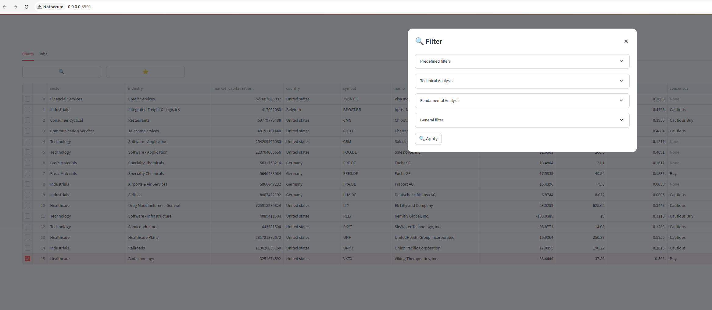
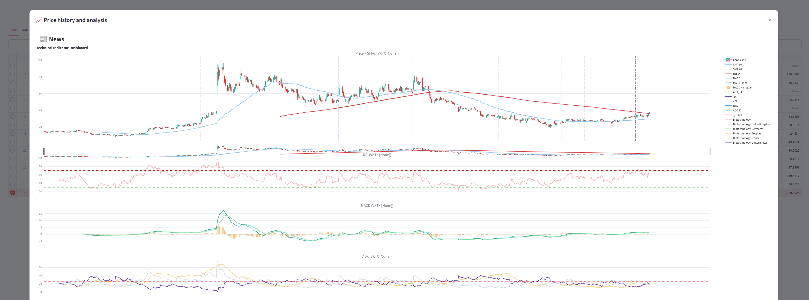

# Bullish

**Bullish** is a high-powered stock screener that helps you quickly identify the best stock or trading opportunities in the market.  
It can scan **thousands of equities** across multiple markets, exchanges, and countries to uncover strong *buy* candidates.  

Bullish uses the well-known **TA-Lib** library to calculate popular technical analysis indicators—such as **RSI**, **MACD**, and moving averages—then lets you filter and select the strongest stocks from your **local database**.

---

## Why Bullish?
The main goals behind Bullish are:
- **Full control over your data** — no dependency on third-party screeners  
- **Local analysis** — run any type of screening or backtesting on your own system  

Bullish is built on:
- **bearish** – a Python library that fetches equity data from multiple sources (*yfinance*, *yahooquery*, *FMP*, …)  
- **tickermood** – retrieves recent, relevant news for screened tickers and uses LLMs to produce an investment recommendation.

---

## Prerequisites
### Install TA-Lib
Bullish depends on **TA-Lib** for technical analysis calculations.  
TA-Lib must be installed separately before using Bullish.  
See the [TA-Lib installation guide](https://ta-lib.org/) for instructions.

---

## Installation
```bash
pip install bullishpy
```

---

## Quick Start

### 1. Create a Bearish Database
A **bearish database** contains historical prices and fundamental data for all stocks in your chosen market.

Example: Create a database for the Belgian stock market:
```bash
bearish run ./bearish.db Belgium
```
You can replace `Belgium` with any supported country.  
**Note:** Building the database can take some time.

---

### 2. Run Bullish
Navigate to the folder containing your **bullish database** and run:
```bash
bullish
```
This launches a **local Streamlit app** where you can screen, filter, and analyze stocks interactively.






---

## Development

Bullish uses [uv](https://docs.astral.sh/uv/) for dependency management and packaging.

```bash
# Install uv (https://docs.astral.sh/uv/getting-started/installation/)
curl -LsSf https://astral.sh/uv/install.sh | sh

# Create the virtual environment and install all dependencies (incl. dev tools)
uv sync --all-groups

# Run the test suite (integration tests excluded)
uv run pytest -m "not integration"

# Linting & type checking
uv run nox -s linting

# Run any command inside the project environment
uv run bullish
```

> **Note:** `ta-lib` is installed from a prebuilt wheel, so the TA-Lib C library
> no longer needs to be built separately for local development on supported
> platforms.

---

## What Bullish Is Not
Bullish is **not**:
- A real-time trading platform  
- A tool for intraday or high-frequency trading  

It is designed for **retail traders** and **swing traders** focusing on opportunities over days or weeks.